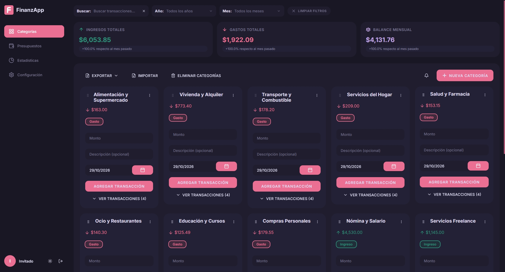
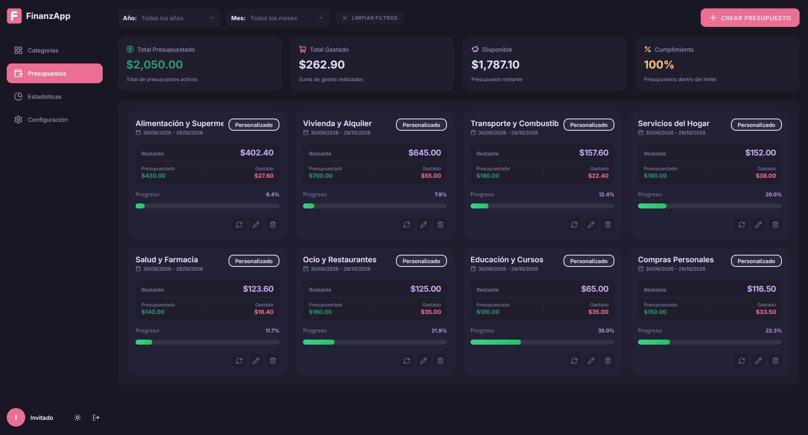
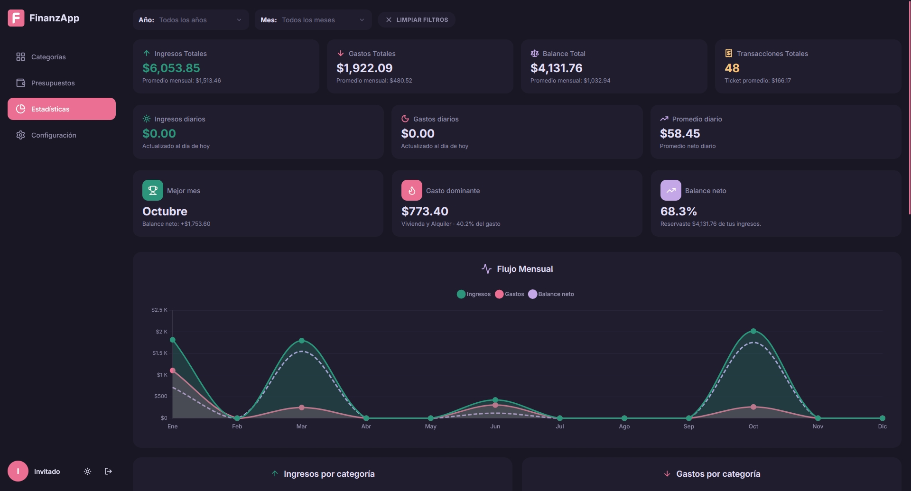
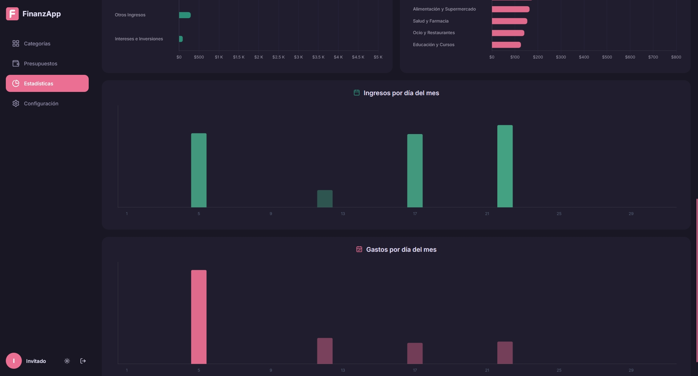
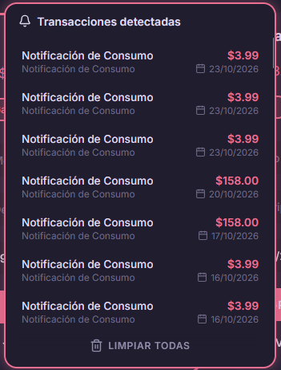

<p align="center">
  
</p>

<h1 align="center">FinanzApp</h1>

<p align="center">
  Organiza tus ingresos, controla tus gastos y da seguimiento a tus presupuestos.
</p>

<p align="center">
  <a href="https://byfinanzapp.com">Abrir aplicación</a> ·
  <a href="#capturas">Ver capturas</a> ·
  <a href="#ejecutar-en-local">Ejecutar en local</a>
</p>

<p align="center">
  <a href="https://github.com/andyhenriquezluciano/FinanzAPP/actions/workflows/ci.yml">
    
  </a>
</p>

FinanzApp es una aplicación web de finanzas personales. Permite registrar movimientos por categoría, consultar el balance y visualizar cómo cambian los ingresos y gastos a lo largo del tiempo. Puedes utilizarla como invitado o iniciar sesión para trabajar con tu cuenta.



*Vista de categorías y transacciones en modo oscuro.*

## Funcionalidades

- **Categorías y transacciones:** registro de ingresos y gastos con monto, descripción y fecha; búsqueda y filtros por año y mes.
- **Presupuestos:** límites por categoría y período, seguimiento del gasto, saldo disponible y barras de progreso.
- **Estadísticas:** indicadores financieros, evolución mensual y distribución de movimientos por categoría y día del mes.
- **Sincronización de correo:** detección de movimientos a partir de notificaciones bancarias mediante Gmail e IMAP, con configuración adicional del backend.
- **Importación y respaldos:** importación de archivos JSON y CSV, exportación de respaldos JSON e informes PDF.
- **Personalización:** temas claro y oscuro, vista compacta de categorías, moneda y formatos de números y fechas.
- **Acceso desde distintos dispositivos:** interfaz adaptable a escritorio y móvil, con almacenamiento local para el modo invitado.

## Capturas

### Presupuestos

Consulta cuánto has presupuestado, cuánto has gastado y cuánto queda disponible en cada categoría.



### Estadísticas y evolución mensual

Resumen financiero con totales, promedios, cantidad de transacciones y comparación mensual de ingresos, gastos y balance neto.



### Distribución diaria

Gráficos para identificar en qué días del mes se concentran los ingresos y los gastos.



### Transacciones detectadas

Panel de notificaciones para consultar los movimientos detectados al configurar la sincronización de correo.

<p align="center">
  
</p>

## Tecnologías

| Área | Tecnologías |
| --- | --- |
| Interfaz | HTML, CSS y JavaScript con módulos ES |
| Desarrollo y compilación | Vite, Node.js y npm |
| Autenticación | Firebase Authentication y Google Identity Services |
| Datos | Cloud Firestore y almacenamiento local del navegador |
| Backend | Cloud Functions for Firebase, Express e integración con Gmail e IMAP |
| Gráficos e informes | Chart.js y jsPDF |
| Pruebas y automatización | Vitest, Playwright y GitHub Actions |

## Ejecutar en local

Necesitas **Git, Node.js 22 actualizado y npm**. La integración continua y el backend utilizan Node.js 22.

### 1. Clonar e instalar

```bash
git clone https://github.com/andyhenriquezluciano/FinanzAPP.git
cd FinanzAPP
npm ci
```

### 2. Generar la configuración e iniciar

```bash
npm run build
npm run dev
```

El primer comando genera los archivos de configuración y la carpeta `public/`. El segundo inicia Vite; por defecto, la aplicación está disponible en **http://localhost:5173**. Si el puerto está ocupado, utiliza la dirección que indique la terminal.

Abre la pantalla de inicio de sesión y selecciona **Continuar como invitado** para probar el registro manual sin configurar una cuenta de Firebase. Los datos del invitado se guardan en ese navegador; puedes exportar un respaldo JSON desde la aplicación.

### 3. Configurar una cuenta de Firebase (opcional)

Copia la plantilla de configuración. En PowerShell:

```powershell
Copy-Item .env.example .env
```

Completa los campos `FIREBASE_*` con la configuración de tu propio proyecto. Habilita los proveedores de autenticación que vayas a utilizar y autoriza el dominio de desarrollo. Para el acceso con Google, configura también `GOOGLE_CLIENT_ID`.

Después de modificar `.env`, vuelve a ejecutar `npm run build` y reinicia el servidor de desarrollo.

### Sincronización de correo (opcional)

La detección de movimientos por correo requiere el backend y las credenciales de los servicios correspondientes:

```bash
npm ci --prefix functions
```

En PowerShell, crea su archivo de configuración:

```powershell
Copy-Item functions/.env.example functions/.env
```

Configura los parámetros de OAuth, los orígenes permitidos y los servicios que vayas a utilizar. Para cifrar las credenciales, define `KMS_KEY_NAME` o una `IMAP_ENCRYPTION_KEY` privada, generada de forma criptográficamente aleatoria y de al menos 32 bytes. El backend rechaza guardar secretos si no dispone de una configuración de cifrado válida.

Define `GMAIL_BACKEND_URL` en el `.env` de la raíz con la URL del backend configurado y accesible, y vuelve a generar la configuración con `npm run build`. La sincronización de correo es independiente del registro manual de movimientos.

Los archivos `.env` y los archivos generados `__config.js` están excluidos de Git. La configuración del cliente contiene parámetros públicos de la aplicación; los secretos de OAuth y cifrado deben permanecer únicamente en el backend.

## Comandos útiles

| Comando | Resultado |
| --- | --- |
| `npm run dev` | Inicia el servidor de desarrollo. |
| `npm run build` | Genera `public/` para Firebase Hosting y los archivos de configuración. |
| `npm run build:vite` | Valida la compilación con Vite y genera sus archivos en `dist/`; requiere haber generado previamente la configuración. |
| `npm test` | Ejecuta las pruebas unitarias. |
| `npm run test:e2e` | Ejecuta las pruebas de navegador. |
| `npm run css:check` | Comprueba enlaces, imports, sintaxis y declaraciones repetidas de CSS para el mismo selector y condición. |

Para ejecutar todas las pruebas unitarias, instala también las dependencias de `functions/`. Antes de ejecutar las pruebas de navegador por primera vez, instala Chromium:

```bash
npm ci --prefix functions
npx playwright install chromium
npm test
npm run test:e2e
```

GitHub Actions comprueba credenciales expuestas, dependencias, sintaxis, estilos, pruebas unitarias y compilaciones en cada cambio a `main` y en las solicitudes de incorporación de cambios dirigidas a esa rama.

## Estructura del proyecto

```text
src/              Páginas, componentes, estilos y recursos de la aplicación
functions/        Backend de sincronización y gestión de credenciales
scripts/          Compilación, revisión de CSS y herramientas de desarrollo
tests/            Pruebas unitarias y datos ficticios de prueba
e2e/              Pruebas de navegación e interacción en el navegador
.github/          Automatización y capturas utilizadas en este README
```

Desarrollado por [andyhenriquezluciano](https://github.com/andyhenriquezluciano).
